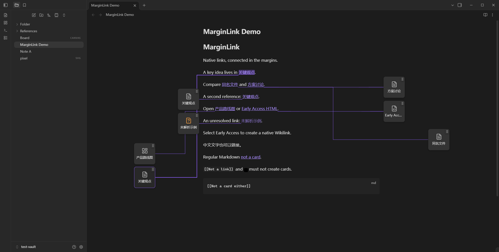
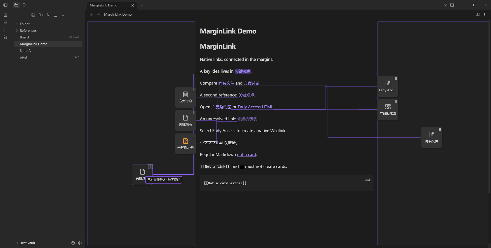
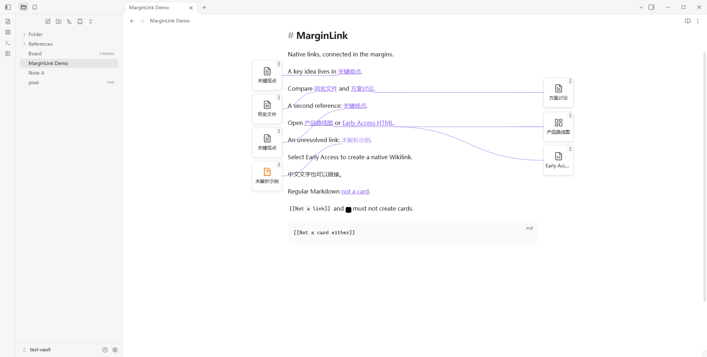
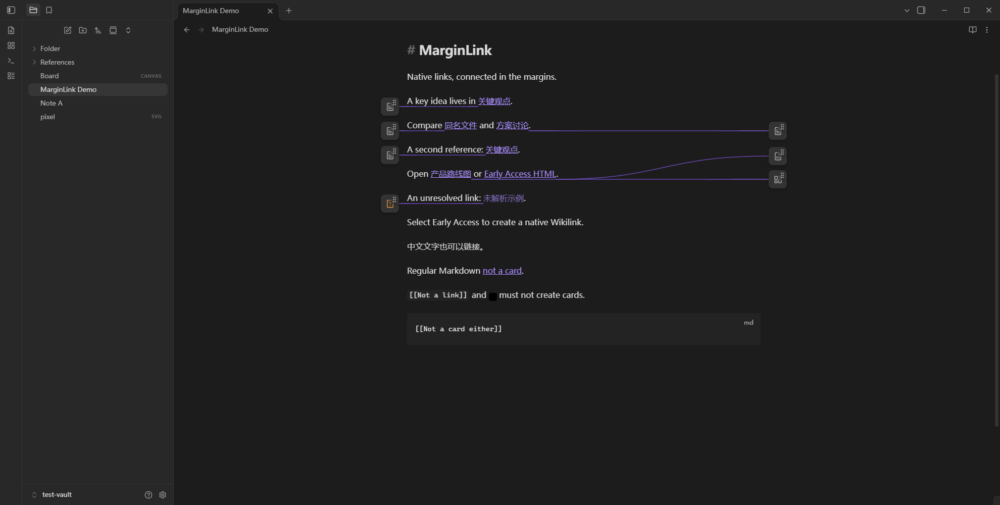

# MarginLink

**Obsidian 原生双链的边缘卡片与空间布局。** 已有 `[[Wikilink]]` 自动显示为卡片；选中文字，用链接手柄或命令选择已有文件，即写入标准 `[[目标路径|原文字]]`。关闭插件后，全部原生链接仍可用。

**v0.2.0 · Spatial Layout & Personalization**，Windows 桌面，最低 Obsidian **1.10.6**。本轮四项核心能力：可调连线、可保存的卡片自由布局、三种卡片形状、分组设置与快捷控制。具体客户端版本、检查结果和未覆盖范围见 [VALIDATION.md](VALIDATION.md)，更新记录见 [CHANGELOG.md](CHANGELOG.md)。

## 安装与升级

本机可安装目录为 `dist/margin-link/`，ZIP 为 `dist/margin-link-0.2.0.zip`。解压，将 `margin-link` 文件夹放到笔记库：

```text
<Vault>/.obsidian/plugins/margin-link/
├── manifest.json
├── main.js
├── styles.css
├── LICENSE
└── THIRD_PARTY_NOTICES.txt
```

进入“设置 → 第三方插件”，按需关闭受限模式，启用 MarginLink。**不要安装到 `D:\SoftWare\Obsidian` 程序目录**；程序安装位置与笔记库插件位置不同。本项目的独立演示库是 `test-vault/`，可用 Obsidian 仓库管理器打开；开发测试不写入你的正式 Vault。

从 v0.1 升级时只替换发布文件，保留原 `data.json`。读取白名单将原来的 `enabled / lines / density / layout` 安全迁移，新增选项补默认值，布局默认仍为 `auto`，避免旧用户突然变更排版。`layout` 继续代表左右优先，新布局模式单独使用 `placementMode`。

Git 仓库不跟踪 `main.js`、`dist/`、依赖或隔离 profile。克隆源码后运行 `npm ci`、`npm run package` 生成安装目录；ZIP 命令见开发章节。此版本没有代替用户发布 GitHub Release 或提交 Obsidian 社区目录。

## 创建和打开原生双链

1. 在 Live Preview 或源码模式选取普通行内文字。选区末端出现**链接手柄**；拖到正文左/右空白带，松手后搜索已有文件。也可用命令“将选中文字链接到文件 / Link selected text to file”，或聚焦手柄后按 Enter。
2. 例如 `Early Access` → `[[References/stages.html|Early Access]]`。只替换原选区，保留空格、中文与 Unicode；一次撤销/重做对应一次创建。
3. Esc、取消弹窗、非法放置、选区/文档版本/活动笔记变化都拒绝提交。不会错误包裹另一段文字。
4. 点击卡片打开实际目标；Ctrl/Cmd 点击新标签，Tab/Enter 操作卡片。原生双链的点击与悬停预览不被截获。未解析卡片显示明确状态，不创建文件。

创建仍限一个连续的普通行内选区：允许软折行，拒绝硬换行、代码、属性、公式、嵌入、已有链接内部、多选区和不安全别名/文件名。**表格内创建暂不支持**，避免别名 `|` 破坏表格。含 `\|` 的转义 Wikilink 保守跳过。普通 Markdown 链接、外部 URL、`![[嵌入]]` 不生成卡片。

## 移动已有卡片

这是独立于“选中文字建链”的操作：从**卡片右上角握柄**开始，不会编辑笔记。

| 模式 | 行为 |
| --- | --- |
| `auto` 自动 | 确定性排列、左右平衡或优先；不写自由坐标，握柄隐藏；已保存的位置保留，切回手动模式可恢复 |
| `free` 自由 | 在当前 MarkdownView 的左右空白带进行二维放置，可跨侧移动；冲突时就近避让，空间不足则省略 |
| `snap` 吸附 | 自由放置加栅格/邻近卡片对齐、边界提示和碰撞避让 |

拖动达到 5px 才进入移动状态；单击握柄不会打开文件。正文上可以显示提示，最终位置必须落在本 leaf 的空白带内。松手保存，**Esc、pointercancel、失焦、焦点进入其他控件、滚动、窗口 resize、切换笔记/模式、文档变化或卸载会取消**。非法或无空间的放置恢复原位置。

键盘操作：Tab 聚焦握柄，方向键移动，Shift+左右键换侧，Delete/Backspace 恢复此卡片自动位置。右键卡片也可恢复单个位置。设置、快捷面板及命令提供“整理/清除当前笔记布局”和“清除所有布局”，清除需确认，双链不受影响。

同一笔记多个 leaf 共享视觉偏好，但每个视图独立测量、裁剪和排布。保存的是 `side + xNormalized + yOffset`：水平值是空白带内的比例，垂直偏移以当前文字行高为单位、相对对应锚点。字体/窗口变化后重新合法化；锚点离屏时卡片和连线移除，可见锚点的超界位置安全裁剪。侧栏动画中短暂隐藏，几何稳定后重现，不用 `position: fixed` 挂在无关段落上。

## 连线与卡片外观

原生“设置 → MarginLink”保留完整设置，按基础、连线、布局、卡片、交互与辅助功能分组。顶部有不修改笔记的实时 DOM/SVG 预览。

- **连线**：隐藏/悬停聚焦/始终显示；曲线/直线/直角折线；1–5px、步长 0.5；常驻透明度 10–100%、默认 65%；主题强调色或紫/蓝/绿/灰预设。激活状态更清晰，`none` 保留卡片与跳转。
- **卡片**：横向、正方形、极简图标；小/中/大。正方形 76/84/92px，图标 32/36/44px；横向按实际空白宽度缩放。可调圆角、边框、阴影和路径显示。窄边距退化到图标，无空间则隐藏；tooltip 与 aria-label 始终保留完整名称、路径和解析状态。
- **布局**：三种模式、左右优先、正文边缘留白、吸附栅格/范围；可清除当前或全部笔记的位置。
- **辅助**：高亮反馈、移动提示、减少动画。系统 `prefers-reduced-motion` 始终生效；不禁止全局文字选择。

命令“打开快捷控制 / Open quick controls”提供显示、连线常驻、模式、形状、当前笔记整理及完整设置入口。完整设置入口用公开 Modal 呈现与原生设置页共用的表单；两处共用同一状态并即时同步，没有私有设置 API 或额外框架。快捷入口不占侧栏，也不强制增加 Ribbon 图标。

| 命令 ID | 用途 |
| --- | --- |
| `margin-link:toggle` | 切换边缘关联显示 |
| `margin-link:link-selection` | 将选中文字链接到已有文件 |
| `margin-link:refresh` | 刷新当前视图 |
| `margin-link:quick-controls` | 打开快捷控制 |
| `margin-link:reset-note-layout` | 确认后清除当前笔记布局 |
| `margin-link:reset-all-layouts` | 确认后清除全部布局 |

不预设全局快捷键，可在 Obsidian 热键设置中自行分配。

## UI 数据与位置恢复边界

**链接关系只在原生双链中；仅外观与个性化布局是插件数据。** 唯一持久化接口是官方 `loadData()/saveData()`，使用版本化 schema 2：

```text
data.json
  schemaVersion: 2
  preferences: 明确白名单中的全局外观与交互选项
  layouts: [{ source, key, side, xNormalized, yOffset, updated }]
```

`source` 是源笔记的 Vault 相对路径；`key` 是原生双链原文、前后各最多 48 字符上下文、相同原文链接数量的组合散列。不保存正文副本、明文别名、目标关系表或稳定 ID，也不向 Markdown 写 ID。散列只用于弱匹配，不是唯一性或隐私加密保证。

恢复前必须重新解析当前双链，并且该上下文散列在整篇文档中唯一，才能应用位置。删除链接不会从旧记录产生卡片。重复完全相同上下文无法区分时拒绝保存；局部上下文、同原文链接数量改变或大幅编辑会使位置失效，宁可自动排布也不猜测另一条链接。远离锚点的前文插入通常不影响匹配。

首版采用保守策略：**任何 Vault 文件/文件夹重命名或删除都会失效全部自定义位置**，避免在缺少可靠迁移依据时错配；不会自行改写 Markdown。普通编辑仅清理当前笔记不再匹配的记录。布局最多 500 条、每笔记 100 条，90 天过期；容错读取、去重和限额，记录缺失或损坏时回退。drop 后约 250ms 合并保存，不在每个 pointermove 写盘；关闭时提交待保存 UI 数据。

清除位置仅回到自动布局；恢复默认外观不删除位置。删除整个 `data.json` 或使用旧版会丢失/重置个性化显示与位置，**原生关联及笔记内容完全保留**。从 v0.1 恢复到 v0.2 时也不能依赖旧程序保留新 schema。

插件没有关系数据库、笔记 sidecar、关联 frontmatter、隐藏标记、localStorage、IndexedDB、遥测或网络请求。关系写入仍只有 `src/editor/selection-action.ts` 的一次安全 `Editor.transaction()`；不使用 `vault.modify()` 覆写笔记。卡片用文本节点，不用 `innerHTML` 执行内容。

## 三种笔记模式、文件类型与兼容性

Live Preview / 源码用 CM6 可见范围和真实 DOM 坐标，解析缓存只在文档变化时更新；阅读模式用官方 Markdown 后处理器、section 源范围与 DOM 顺序映射。重复引用各有独立锚点和卡片；普通 Markdown/参考式链接参与消歧。第三方 DOM 改写使数量不一致时省略该目标组。

每个 MarkdownView 有独立 overlay、SVG、观察器及坐标系。滚动、字体和主题变化合并到 rAF；只显示可见锚点，自己的 DOM/CSS 更新不触发无限重绘。窄窗或密集区域允许省略卡片，不挤压正文、不强制修改“限制行宽”。

文件选择仅来自 `Vault.getFiles()`，目标使用原生 `getFirstLinkpathDest()`，创建时验证精确完整路径以区分同名文件。标题/块子路径保留。Markdown、Canvas、Bases、PDF、原生图片/音视频通过 `WorkspaceLeaf.openFile(TFile)` 打开。

**HTML/思维导图能解析不等于有查看器**：

1. 在独立库添加 `References/stages.html`，写 `[[References/stages.html|Early Access]]`。
2. 在文件选择器搜索路径；找不到只表示 Vault 未暴露，不能推断磁盘文件不存在。卡片未解析时不创建替身。
3. 若可解析而无已确认查看器，卡片只提示，不启动系统应用、不执行 HTML、不转换 Markdown。
4. 安装相应类型插件后，先用它打开一个同类文件并**保留兼容 FileView 标签**，公开 `canAcceptExtension()` 确认后再从卡片打开。

公开 API 无法枚举尚未打开的第三方处理器，这一降级继续保留。用户主题、第三方 DOM/悬停预览插件、popout 编辑窗口、macOS/Linux、移动端、RTL 及全部媒体格式组合仍需人工验收。1.15.0 更新包与旧安装程序的独立设置窗口在 CDP 下会有宿主告警；无插件对照和未确认的具体原因见验证报告。

## 源码与开发

| 入口 | 职责 |
| --- | --- |
| `src/main.ts`, `src/types.ts` | 生命周期、命令、共享偏好、迁移读取和串行保存 |
| `src/core/layout-identity.ts`, `layout-store.ts` | 弱身份、UI 位置白名单、限额、过期和失效 |
| `src/core/` 其余文件 | Markdown 保护区域、精确原生目标、安全格式化、文件能力 |
| `src/editor/`, `src/reading/` | 安全选区创建、CM6/阅读锚点与各自生命周期 |
| `src/view/layout-engine.ts` | 相对坐标、形状尺寸、碰撞/吸附与裁剪纯函数 |
| `src/view/card-drag-controller.ts` | 已有卡片移动及取消，独立于建链手柄 |
| `src/view/margin-overlay.ts`, `appearance.ts` | 每视图协调、局部几何与主题变量 |
| `src/ui/settings-tab.ts`, `quick-controls.ts` | 共享原生表单、实时预览、快捷 Modal 与确认 |
| `scripts/desktop-test.mjs`, `desktop-v2.mjs` | 隔离库客户端回归与 v0.2 场景 |

Node 24 / npm 12，安装与常规检查：

```powershell
npm ci
npm test
npm run lint
npm run build
npm run package
Compress-Archive -LiteralPath dist/margin-link -DestinationPath dist/margin-link-0.2.0.zip -Force
```

构建含严格 TypeScript 检查，esbuild 输出 CJS；Obsidian/CM6 由宿主提供。打包附带实际 bundled 依赖许可证。`npm run dev` 用于监听构建。

真实桌面验收会重写测试笔记、测试偏好及工作区，只能在本项目独立库执行：

```powershell
npm run build
node scripts/setup-test-vault.mjs
powershell -ExecutionPolicy Bypass -File scripts/launch-test.ps1
# 首次信任自己生成的隔离库后运行
npm run test:desktop
```

更改源码后重建并把三个插件文件复制到测试目录，重新加载实例。准备脚本包含 v0.1 偏好夹具，以验证迁移；不要在隔离实例仍运行时重置夹具。启动脚本默认 `D:\SoftWare\Obsidian\Obsidian.exe`，可传 `-ObsidianExe`；profile 为 `test-profile/`，CDP 端口本机 9223，完成后关闭该实例。

`node scripts/host-window-control.mjs` 是编辑器设置窗口的卸载插件对照；`node scripts/restart-layout-check.mjs prepare` → 完全关闭并重新启动隔离实例 → `verify`，检查实际卡片恢复和所有 Markdown 哈希。上述脚本都有独立库校验，不运行于正式库。

协作规则见 [AGENTS.md](AGENTS.md)，[standard 工程记忆](wiki_memory/README.md) 保存状态与决策。每轮有项目修改均验证、同步必要记忆、提交并推送已核实 upstream；无变化不造空提交。源码仓库为 [DewMysimple/MarginLink](https://github.com/DewMysimple/MarginLink)。

## 人工验收

1. 打开独立库，切 Live Preview / 源码 / 阅读模式，已有双链逐次显示；代码、嵌入、普通链接不显示卡片。
2. 原生选区手柄与命令都只生成精确 `[[...|原文字]]`，检查取消、过期快照、撤销/重做、中文与同名文件。
3. 在三种模式调节线型、宽度、透明度、颜色，`none` 留下卡片，设置预览与实际页面同步。
4. 在 free/snap 中拖卡片跨侧、上下及横向移动；确认正文/其他 pane 无遮挡，Esc、失焦和界外放置恢复。
5. 完全退出再启动，在足够宽的视图恢复位置；缩窄后安全隐藏，放宽后恢复；滚动时跟随正确锚点，离屏没有漂浮连线。
6. 切三形状与小中大尺寸、明暗主题、字体、缩放、侧栏、限制行宽、不同文件分屏及同文件多个 leaf。
7. 重复同目标/同别名分别移动；远处编辑前文，删除/增加同原文链接、改变周围文字、重命名文件，确认不会把旧位置套给别的锚点。
8. 键盘打开卡片、操作握柄、恢复单卡/当前笔记/全部位置；确认其他笔记仅在全局清理或明确的重命名/删除失效策略下变化。
9. 在自己的 HTML/思维导图处理器、Page Preview/主题组合下验证特殊格式提示及原生打开。
10. 清除布局、删除 data.json、禁用/卸载：Markdown 字节和双链保留，无幽灵关系、overlay、pointer capture、监听或附加类。

自动化已测范围和剩余人工环境缺口以验证报告为准，不把这份清单视为全部平台通过。

## 实际截图

以下来自隔离 Obsidian 的实际 Electron 渲染，不是设计稿：









另有阅读、源码、分屏和窄窗截图及版本化 JSON 结果。当前没有操作动图。

## 参考

- [官方插件样板](https://github.com/obsidianmd/obsidian-sample-plugin)
- [官方 TypeScript API](https://github.com/obsidianmd/obsidian-api)
- [Manifest 规范](https://docs.obsidian.md/Reference/Manifest)
- [支持的文件格式](https://obsidian.md/help/Files%20and%20folders/Accepted%20file%20formats)

MIT License；依赖许可证随发布文件附带。
