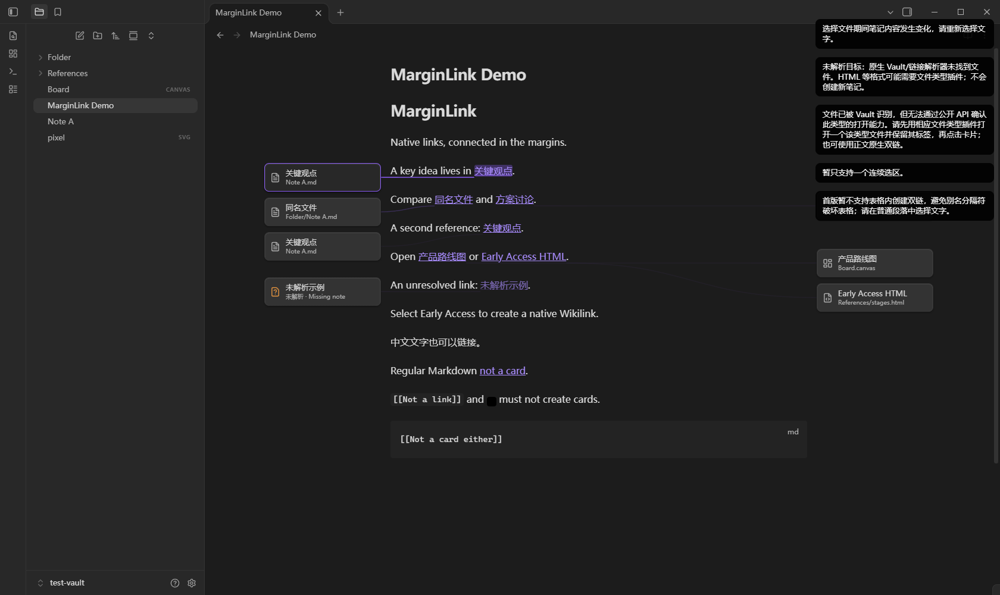
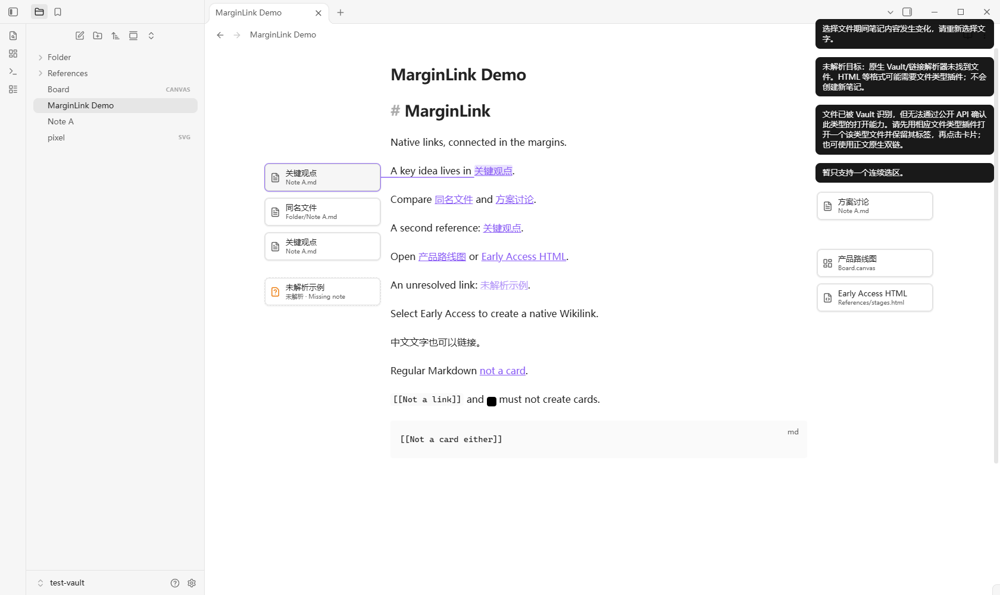
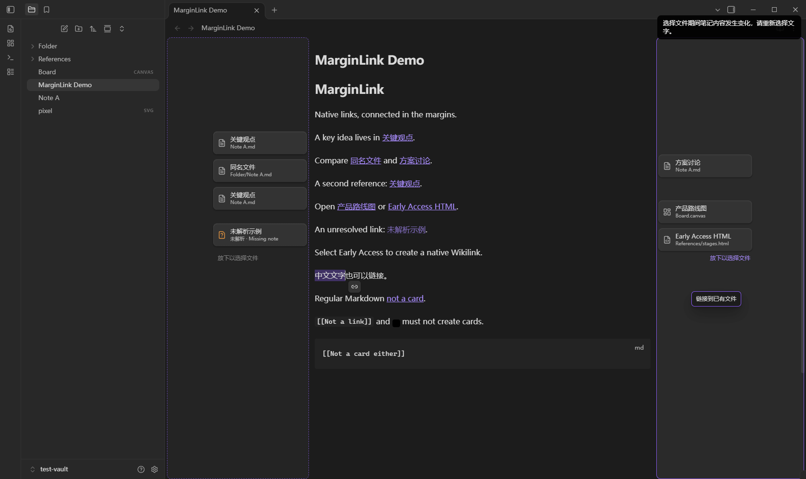

# MarginLink

把 **Obsidian 原生 Wikilink** 显示成正文两侧的文件卡片。选中文字、拖动链接手柄到边缘、选择已有文件，即生成 `[[目标路径|原文字]]`。插件关闭后，原生双链照常使用。

Windows 桌面 MVP · v0.1.0 · 最低版本 **Obsidian 1.10.6**。已在本机安装包内置的 1.10.6，以及用户已有更新包 1.15.0 的隔离实例中进行桌面自动验收。声明最低版本采用实际运行过的版本，不承诺更早版本。公开 API 类型使用锁文件中的 `obsidian@1.14.4`；插件只调用其中已公开的接口。

## 安装

已经生成的发布目录是 `dist/margin-link/`，压缩包是 `dist/margin-link-0.1.0.zip`。将其中 **margin-link 文件夹**复制到要启用插件的笔记库：

```text
<你的 Vault>/.obsidian/plugins/margin-link/
├── manifest.json
├── main.js
└── styles.css
```

发布目录还附有许可证及依赖许可证，可以一起复制。不要在 `D:\SoftWare\Obsidian` 程序目录里安装插件。应用安装目录与笔记库的插件目录是两件事。

进入 Obsidian → 设置 → 第三方插件，按需要关闭受限模式，启用 **MarginLink**。复制时应用已开着但列表没有更新，可以重新加载应用。无需 npm，也无需构建源码，便可安装发布文件。

本项目已准备独立演示库：`C:\Users\Administrator\Desktop\ObExrension\test-vault`，其中已装好当前插件。通过 Obsidian 的仓库管理器选择“打开本地仓库”，打开该目录即可。首次打开会显示信任插件提示；这是本项目自己生成的测试库。所有测试夹具均在此库，开发过程没有向你的正式 Vault 写入测试文件或安装插件。

## 使用

1. 打开带有 `[[Note A|关键观点]]` 等原生双链的笔记，已有链接自动出现卡片。每次引用单独显示；标题和块子路径保留。
2. 在 Live Preview 或源码模式中，选取一段普通行内文字。选区末端下方会显示小型链接手柄。用手柄拖到正文左侧或右侧空白，放下后搜索文件名或路径，选择已存在文件。
3. 只会替换原选区，例如 `Early Access` → `[[References/stages.html|Early Access]]`。普通软折行可以，硬换行和复杂结构不可以。空格、标点、中文和完整 Unicode 字符按原文保留。
4. Esc、取消弹窗、拖到正文或其他非法区域，都不会写入。选文件期间原文被改动、选区改变、切换文件/活动 leaf、关闭编辑器或窗口失焦时，本次操作取消或在提交时拒绝。
5. 拖拽不方便时，打开命令面板，搜索 **MarginLink** → **将选中文字链接到文件 / Link selected text to file**。也可让手柄获得键盘焦点后按 Enter。
6. 悬停正文双链或卡片，会高亮相应文字、节点与连线。卡片支持 Tab 聚焦和 Enter/Space 激活。Ctrl/Cmd 点击在新标签打开。正文原生点击和悬停预览没有被截获。
7. 在插件设置里可切换连线常显/悬停、卡片自动/紧凑、左右优先模式。宽卡片显示路径，紧凑图标通过 tooltip 和 aria-label 提供完整路径。

命令面板提供三个命令，不分配全局快捷键：

| ID | 命令 |
| --- | --- |
| `margin-link:toggle` | 切换边缘关联显示 / Toggle margin links |
| `margin-link:link-selection` | 将选中文字链接到文件 / Link selected text to file |
| `margin-link:refresh` | 刷新边缘关联 / Refresh margin links |

默认只在悬停、选中或聚焦时显示高亮连线。没有看到连线时，可以悬停一张卡片，或将设置改为“始终显示”。

## 布局和模式

- **Live Preview**：从当前未保存的编辑器文档解析 Wikilink，用 CM6 的可见范围和实际 DOM Range 定位；支持手柄创建。
- **源码模式**：使用真实 token/别名的 DOM 坐标定位；正常显示 Markdown 控制字符，支持创建。
- **阅读模式**：用官方 Markdown 后处理器、section 源码范围和 DOM 顺序映射，不提供编辑手柄。普通 Markdown 链接和参考式链接参与消歧，但不会生成卡片。重复目标/别名按每次源码出现分别对应。
- 每个 MarkdownView 有独立 overlay、SVG 和 observer；支持分屏、多个标签和同一笔记的独立视图。滚动、resize、字体重排、CSS 变化会合并到下一帧更新。
- 按真实正文宽度选择左右边缘；足够宽时用卡片，较窄时用图标，空白不足约 60px 时隐藏该侧。可用高度不足时省略超额卡片，优先保证不重叠、不越界。隐藏不会删除任何双链。
- 只渲染可见锚点，避免离屏连线。正文滚轮和选区保持原生行为。插件不强制开启“限制行宽”；打开该选项、放大窗口或关闭一侧边栏通常能提供更多空间。

**双链关系永久保存，卡片的空间布局不承诺跨会话固定。** 拖到左/右边后，新卡片在当前编辑器版本里优先放在对应侧；下一次编辑、重新打开文件或重启插件，就重新运行确定性的自动布局。不会为了记住位置写入任何数据。

## 文件类型、HTML 和特殊格式

解析使用 `MetadataCache.getFirstLinkpathDest()`，文件选择器只使用 `Vault.getFiles()`。不会扫描磁盘寻找替身，不会把未解析名称猜成某个文件。创建时使用原生解析器核对精确目标，Markdown 文件也保留 `.md` 扩展名，以便区分同名文件；不受“使用 Wikilinks”开关影响，最终始终是 `[[...|...]]`。

Markdown、Canvas、Bases、PDF、原生图片/音视频格式通过官方 `WorkspaceLeaf.openFile(TFile)` 打开。标题和块引用作为子路径传给原生视图。不同格式本身的编辑/预览能力由 Obsidian 决定。

`.html/.htm` 和一些思维导图扩展名不属于默认内置查看格式。**能被 Vault 找到不等于有查看器**：

1. 在测试库放入 `References/stages.html`，在正文写 `[[References/stages.html|Early Access]]`。
2. 打开插件文件选择器搜索完整路径：找不到时，本机 Vault 没有把它作为可选择文件暴露；不要推断磁盘文件不存在。已有双链仍保留，解析失败时卡片显示“未解析”。
3. 若能被选择和解析，卡片会显示真实文件路径。本机 1.10.6/1.15.0 都暴露了该测试 HTML，但没有内置 HTML 查看器。
4. 特殊类型的卡片会先检查公开 `FileView.canAcceptExtension()`。若无法确认支持，只显示能力提示，不启动系统应用、执行 HTML 或生成笔记。
5. 安装合适的文件类型处理插件，**先通过该插件/原生入口打开一个该类型文件，并保留它的标签**。已有 FileView 能确认支持后，MarginLink 才用标准接口打开相应目标。

公开 API 无法枚举尚未打开的第三方类型注册表，因此“已装插件但从未打开该类视图”也会触发上述保守提示。这是首版明确的降级。没有读取私有注册表，也没有实现 HTML 查看器；不把 HTML 变成 Markdown 替身。第三方类型插件的具体兼容性还需要你在自己的插件组合中手工验证。

## 数据与安全

运行时只从 Markdown 双链派生 occurrence、偏移量、目标文件和布局；它们全在内存中。源码写入只有 `src/editor/selection-action.ts` 中的一次公开 `Editor.transaction()`，只替换用户选区，支持单步撤销/重做。没有覆写整篇文件的 `vault.modify()`。

插件唯一的持久化入口是 `saveData(readPreferences(...))`，白名单只含四项：`enabled`、`lines`、`density`、`layout`。Obsidian 可以为这些 UI 偏好生成正常的 `.obsidian/plugins/margin-link/data.json`；该文件没有文件路径、每条链接的 ID、坐标、关系表或笔记内容。删除它只会重置显示偏好。

没有关系数据库、sidecar、frontmatter 关联字段、隐藏注释、隐藏 ID、自定义关系格式、localStorage、IndexedDB、遥测或网络请求。读取 DOM 里 Obsidian 原有的 `data-href` 只用于定位，不会将任何 `data-*` 写回笔记。文件名和别名以文本节点显示，不使用 `innerHTML` 或内嵌执行目标内容。

## 当前边界

- 创建只支持一个连续的普通行内选区。跨硬换行、代码、属性、公式、已有链接/嵌入、块标记、多选区，以及含 `|`、方括号、反斜杠等不能安全表示的别名，都会被拒绝。
- **表格内创建暂不支持**，避免新双链里的别名管道字符破坏表格。已存在的常规 Wikilink 可解析，但使用 `\|` 等转义写法的 Wikilink 首版保守跳过。目标文件名含 `#`、`^`、`|`、方括号等特殊字符时，创建会拒绝且不改原文。
- 阅读模式依赖原生后处理 section 信息。HTML 或其他插件增删链接，导致同一目标的源码出现次数与真实 DOM 数量不一致时，省略该目标组的卡片，避免挂错文字。不会把“取第一个同名节点”当作可靠映射。
- 超密集链接会省略部分卡片；窄窗会隐藏。不存在永久坐标、自定义展开侧栏或任意拖动卡片的能力。
- 已验证默认主题和 Windows 桌面，尚未验证 macOS/Linux、移动端、RTL、复杂自定义主题、大量第三方 DOM 改写和独立 popout 编辑窗口。分屏及独立设置窗口在实际桌面中已测试。原生悬停预览不受接管，但不同预览插件组合仍需手工验收。
- 当前 1.15.0 更新包配合 1.10.6 安装程序，在 CDP 自动切换主题并关闭独立设置窗口时，会记录无堆栈的 `illegal access` 宿主告警。在卸载所有社区插件并重新加载的对照测试中同样复现。功能断言通过，日志不会隐瞒；详细记录与人工复核范围见 `VALIDATION.md`。此现象不能归因为插件，也不宣称已经修复宿主。

## 源码结构

| 文件/目录 | 职责 |
| --- | --- |
| `src/main.ts`、`src/types.ts` | 官方生命周期、命令、事件、纯 UI 偏好白名单 |
| `src/core/` | 排除 Markdown 保护区域、原生链接解析、精确路径与安全格式化、文件打开能力 |
| `src/editor/` | CM6 可见坐标、原文版本快照、单事务编辑、手柄与拖拽取消状态 |
| `src/reading/` | 官方后处理器与子组件生命周期、section 内源位置/DOM 顺序消歧 |
| `src/view/` | 每视图 overlay、SVG 曲线、主题卡片、确定性防重叠布局 |
| `src/ui/` | 原生 FuzzySuggestModal 文件选择器、设置页 |
| `tests/` | 核心逻辑测试和仓库内夹具 |
| `scripts/` | 打包、独立测试库准备、隔离实例启动、Playwright 桌面验收 |

## 开发与自动验证

源码仓库：[DewMysimple/MarginLink](https://github.com/DewMysimple/MarginLink)。仓库保存源码、锁文件、测试夹具，以及本文引用的截图与验证报告；`node_modules/`、`main.js`、`dist/` 和隔离 `test-profile/` 不纳入 Git。克隆源码后先运行 `npm ci`，再运行 `npm run package` 生成安装文件夹；ZIP 按下方命令生成。本机原有的发布文件仍保留在 `dist/`。

Node.js 24 / npm 12 已实际执行：

```powershell
npm install
npm run build
npm test
npm run lint
npm run package
# 可选：更新 ZIP 安装包（PowerShell）
Compress-Archive -LiteralPath dist/margin-link -DestinationPath dist/margin-link-0.1.0.zip -Force
```

`build` 包含严格 TypeScript 检查与浏览器目标的 CJS 构建；Obsidian 和 CM6 由宿主提供，不重复打包。`npm run dev` 启动构建监听。发布安装不依赖 Node、Electron 模块或第三方前端框架。

桌面验收仅针对本项目的独立测试库，会重写测试夹具，勿改成正式库路径：

```powershell
npm run build
node scripts/setup-test-vault.mjs
powershell -ExecutionPolicy Bypass -File scripts/launch-test.ps1
# 首次信任自己生成的测试库，然后运行：
npm run test:desktop
```

若更改了源码，重新构建后把三个发布文件复制到测试插件目录，再重新加载测试实例。`setup-test-vault.mjs` 会重置演示笔记、测试设置和测试工作区，适合关闭测试实例后运行。

`launch-test.ps1` 默认使用 `D:\SoftWare\Obsidian\Obsidian.exe`，可传 `-ObsidianExe` 改路径。隔离 profile 在 `test-profile/`，调试端口为本机 9223。开发完成后关闭该测试实例即可。默认新 profile 用安装包内置的版本；本次为了验证 1.15.0，只复制了本机现有更新包到隔离 profile，没有复制用户笔记或账户数据。

**实际结果**详见 [VALIDATION.md](VALIDATION.md)。自动化结果 JSON、布局截图在 `artifacts/`。截图来自真实 Obsidian Electron 渲染器，通过 CDP 设置 1680px/2600px 测试视口；不是静态 HTML 或设计稿。

## 人工验收清单

以下步骤供你在自己的屏幕、主题及文件类型插件组合下复核。前述默认环境的核心流程已做自动桌面测试，这份清单用于用户环境验收，不代表所有组合都已验证。

1. 用仓库管理器打开 `test-vault`；启用“限制行宽”和 MarginLink。打开 `MarginLink Demo.md`，确认 `[[Note A|关键观点]]` 的卡片和悬停曲线。
2. 切到 Live Preview，选取普通句子中的 `Early Access`，将小链接手柄拖到右边空白，搜索选择已有文件。源码应只多出 `[[目标路径|Early Access]]`。
3. 撤销后，用命令面板“将选中文字链接到文件”再做一次，确认相同结果；检查原始空格、中文和标点未丢。
4. 点击卡片打开真实目标；Tab 聚焦/Enter 激活；正文双链和卡片互相悬停高亮。正文原生点击与页面预览仍可用。
5. 切换源码和阅读模式；锚点对齐实际文字，每次引用分别显示。阅读模式没有编辑手柄。
6. 开关侧边栏、调窗口宽度、可读行宽和字体，滚动长文，切明暗主题。卡片可缩小/隐藏，但不能压住正文或横向溢出。
7. 分屏打开不同文件，观察各自卡片，切标签再返回。窄分屏允许安全隐藏。
8. 在某条双链前插入很多文字，确认锚点重排；改双链目标，卡片应变化。
9. 新增双链后执行一次撤销、一次重做，检查卡片消失/恢复，正文其余字符不变。
10. 在测试库内重命名/删除目标，观察原生链接更新和未解析状态；插件不执行自己的全库重命名引擎。
11. 试 `.canvas`、图片、PDF/音视频及 `.html`。对 HTML 按“文件类型”章节，分别验证无查看器、有已打开的兼容 FileView 时的不同结果；思维导图扩展同理。
12. Esc 取消拖拽/弹窗、拖回正文、跨段落/表格/代码选区、选文件时改原文或换活动笔记，确认没有意外包裹别的文字。
13. 禁用或卸载插件，确认图层/高亮消失，原生双链仍在；检查没有新增关系数据库、注释、frontmatter 字段或 sidecar。

## 实际截图

深色模式与悬停连线：



浅色模式：



拖动手柄到右侧：



另有 `artifacts/reading.png`、`source.png`、`split.png`、`narrow.png`、`scroll.png`。当前提供实际静态截图，尚未录制操作动图。

## 参考资料

- [Obsidian 官方插件样板](https://github.com/obsidianmd/obsidian-sample-plugin)
- [Obsidian 官方 TypeScript API 定义](https://github.com/obsidianmd/obsidian-api)
- [插件 Manifest 规范](https://docs.obsidian.md/Reference/Manifest)
- [官方支持的文件格式](https://obsidian.md/help/Files%20and%20folders/Accepted%20file%20formats)

MIT License；打包依赖许可证随发布目录附带。
