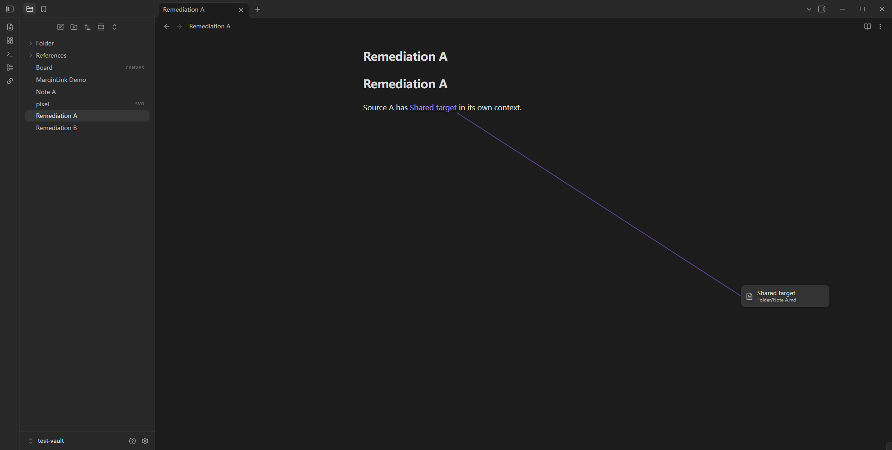
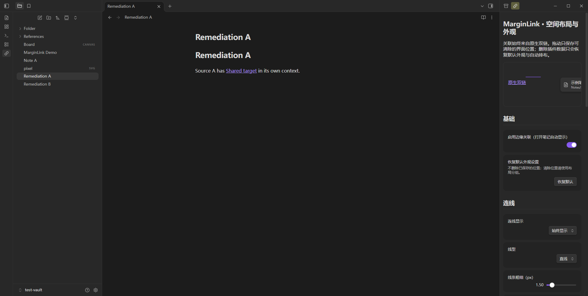

# MarginLink

**Obsidian 原生双链的边缘卡片与空间布局。** 已有 `[[Wikilink]]` 自动显示为卡片；选中文字，用链接手柄或命令选择已有文件或新建 Markdown，即写入标准 `[[目标路径|原文字]]`。关闭插件后，全部原生链接仍可用。

在「设置 → MarginLink → 卡片」开启 **合并同一文件的重复引用**，每个已解析文件在当前笔记边缘显示一张卡片。数字是全文引用次数。点击数字可查看别名、原文行号与目标子路径，并定位、重链或取消其中一处。点击卡片主体打开文件，Ctrl/Cmd 点击在新标签打开。

此选项默认关闭。开启时四种布局均使用只读临时卡位；关闭后恢复逐处卡片和已保存的位置。未解析的引用各自显示。

**v0.3.2**，最低 Obsidian 桌面版本 **1.10.6**。右键卡片可取消当前文件链接，布局设置支持最多 300 px 正文边缘留白。[本版验证记录](VALIDATION.md)

## 安装与升级

本机可安装目录为 `dist/margin-link/`，ZIP 为 `dist/margin-link-0.3.2.zip`。解压，将 `margin-link` 文件夹放到笔记库：

```text
<Vault>/.obsidian/plugins/margin-link/
├── manifest.json
├── main.js
├── styles.css
├── LICENSE
└── THIRD_PARTY_NOTICES.txt
```

进入“设置 → 第三方插件”，按需关闭受限模式，启用 MarginLink。**不要安装到 `D:\SoftWare\Obsidian` 程序目录**；程序安装位置与笔记库插件位置不同。本项目的独立演示库是 `test-vault/`，可用 Obsidian 仓库管理器打开；开发测试不写入你的正式 Vault。

升级时只替换发布文件，保留原 `data.json`。旧平铺配置与当前嵌套配置中的合法选择逐项保留，包括“悬停”“自动排列”“横向卡片”；只有缺失或无效的字段采用新默认。新安装仍为 `lines=always`、`placementMode=free`、`cardShape=square`。恢复默认外观会保留当前布局模式、位置、左右偏好和栅格值。`layout` 仅影响自动排列及自动初排，完全手动不使用它。

Git 仓库跟踪源码。克隆后可双击 Windows 的 `buildStart.cmd` 生成 ZIP，或运行 `npm ci`、`npm run package` 生成安装目录。

## 创建和打开原生双链

1. 在 Live Preview 或源码模式选取普通行内文字，**单击选区旁的链形图标**即可打开“关联文件”，搜索已有文件或新建 Markdown。也支持将图标拖到左右空白带、聚焦后按 Enter/Space，或使用命令“将选中文字链接到文件 / Link selected text to file”。
2. 例如 `Early Access` → `[[References/stages.html|Early Access]]`。只替换原选区，保留空格、中文与 Unicode；一次撤销/重做对应一次创建。
3. Esc、取消弹窗、非法放置、选区/文档版本/活动笔记变化都拒绝提交。不会错误包裹另一段文字。
4. 点击卡片打开实际目标；Ctrl/Cmd 点击新标签，Tab/Enter 操作卡片。原生双链的点击与悬停预览不被截获。未解析卡片显示明确状态，不创建文件。

新建笔记时可以在设置中预设三个存放目录。普通点击“创建并链接”后回到原文继续输入，按住 Ctrl 点击会立即在独立 Obsidian 窗口中编辑新笔记。文件名可修改，原选文字用作别名，例如 `[[详细分析/Vocabulary/model-assisted.md|model-assisted]]`。

“已有文件”也接受本机绝对路径，包括外围配对引号、空格和中文。库内路径精确关联原文件；库外路径先显示来源、预设存放位置和最终库内路径。点击“移动到仓库并关联”后，插件分块复制并校验摘要，确认双链写入成功，再复核并删除来源。附件保留原扩展名与字节；重名可改名或“使用已有文件（保留原件）”。取消、文件变化或失败时保留可恢复文件，并显示已完成的阶段。删除来源失败时可经过再次校验重试。撤销双链会保留导入附件。

右键任意卡片可选“重新链接文件…”，包括失效目标。面板打开后可直接输入文件名或路径，方向键选择、Enter确认。只替换这一次出现位置，保留显式别名或无别名形式；原子路径无法在新目标核实时，需选择保留或移除。重链后保留当前视口，阅读模式也能操作。等待期间源文或其他分栏发生修改时拒绝提交，需重新选择。

选择“取消链接文件”可将当前这一次双链还原为文字。有别名时保留别名，无别名或别名为空时保留目标文字（含路径和子路径）。其他引用和目标文件保留。需要恢复时，在编辑模式使用 Obsidian 原生撤销。

创建仍限一个连续的普通行内选区：允许软折行，拒绝硬换行、代码、属性、公式、嵌入、已有链接内部、多选区和不安全别名/文件名。**表格内创建暂不支持**，避免别名 `|` 破坏表格。含 `\|` 的转义 Wikilink 保守跳过。普通 Markdown 链接、外部 URL、`![[嵌入]]` 不生成卡片。

## 在当前笔记中导航

| 操作 | 效果 |
| --- | --- |
| 悬停或 Tab 聚焦卡片 | 突出这一次引用的文字、卡片和所经线段。编号续接会同时突出两端编号。 |
| 卡片上按 **P**，或右键选“固定此处关联高亮” | 固定当前路径。再次按 P 取消固定，也可在另一张卡片按 P 切换。 |
| 悬停约半秒，或聚焦卡片按 **V** | 查看文件名、类型及本地 Markdown 摘要。鼠标可以移入面板继续阅读；键盘打开后可用 Tab 到“打开文件”。 |
| **Escape** | 关闭预览、取消固定。键盘预览会将焦点还给原卡片。 |
| 设置 → 卡片 → 分组方式 | 选择“文件夹”或“文件类型”，再用笔记标题栏的分组按钮按名称和数量折叠、展开。隐藏标题栏时可使用命令“折叠或展开当前笔记的卡片分组”。 |

分组默认关闭。文件夹取目标的完整库内父目录，根目录显示为 `/`，失效引用归入“未解析目标”。相同目标的每次引用各占一张卡，分组沿用现有位置；折叠只影响操作所在的分栏。文件类型会合并图片、HTML 等同类扩展名。

摘要以纯文本显示，最多 700 个 Unicode 码点。超过 256 KiB 的笔记及附件只显示文件信息；边距不足时使用紧凑提示。每个窗格最多缓存 24 条摘要，复用期限为 60 秒，目标变化与视图释放会使缓存失效。悬停预览保留当前编辑焦点和视口。

## 移动已有卡片

在完全手动/自由/吸附模式，按住**卡片图标、文件名或空白处**即可拖动，不会编辑笔记。已有卡片没有独立握柄；正文选中文字后的链接手柄继续用于创建双链。

| 模式 | 行为 |
| --- | --- |
| `manual` 完全手动 | 进入时保留当前已显示布局；返回、重开后恢复位置，不自动平衡、吸附或挤开其他卡片。新出现的卡片在对应文字邻近侧给一个独立初始位置，可自行拖开重叠 |
| `auto` 自动 | 确定性排列、左右平衡或优先；不拖动、不写自由坐标；已保存的位置保留，切回手动模式可恢复 |
| `free` 自由 | 首次显示时自动初排并记住位置；二维放置、可跨侧，允许重叠，只更新当前卡片 |
| `snap` 吸附 | 首次显示时自动初排并记住位置；仅当前拖动卡片按栅格吸附，允许重叠，不推开其他卡片 |

在完整设置、原生设置页或快捷控制选择“完全手动”。此时“自动排布左右优先”停用；栅格间距仅在智能吸附模式可调。原有自由/吸附/自动选择不会在升级时暗改。保存仍受每笔记100条、全局500条、90天保留和弱身份唯一性限制；首次显示初始化不会挤掉已有位置，超限或无法唯一辨别时按当前模式提供初始位置。

移动达到约 5 个 CSS 像素才开始拖动；第一帧起保留按下时的整卡抓点，跨侧改变尺寸时保留抓点比例。单击卡片任意位置打开文件，Ctrl/Cmd 单击新标签。合法松手立即提交内存位置并抑制本次拖动产生的点击，下一次单击正常打开。拖动中没有跟随文字或悬停提示，“显示拖动边界”只控制空白带视觉反馈。最终位置必须落在本 leaf 的空白带内。**Esc、pointercancel、失焦、焦点进入其他控件、滚动、窗口 resize、切换笔记/模式、文档变化或卸载会取消**。非法或无空间的放置恢复原位置。

键盘操作：Tab 聚焦卡片自身，Enter/Space 打开，方向键移动，Shift+左右键换侧，Delete/Backspace 重置此卡片初始位置。右键也可重置单张卡片。设置、快捷面板及命令可重置当前笔记或全部保存的位置，确认后保持原布局模式；完全手动不会因此切回自动平衡。双链不受影响。

同一笔记多个 leaf 共享视觉偏好，但每个视图独立测量、裁剪和排布。保存的是 `side + xNormalized + yOffset`：水平值是空白带内的比例，垂直偏移以当前文字行高为单位、相对对应锚点。卡片、线和编号位于可编辑 DOM 之外的原生滚动内容层，使用同一个滚动变换并自然裁切，不撑大滚动高度。已测区间保留现有 DOM 和安全路线；宿主虚拟化引起整段微移时，曲线精确跟随并重新核验当前障碍，只有受影响的路线重新搜索。滚动期间即时处理必要几何，静默后再尝试共享优化；不在滚动中保存位置。拖动侧栏或分屏分隔线时，同一窗格统一更新，横向空间不足只影响对应卡片，不修改保存的位置。

自由和吸附模式会在当前视图中为相撞的初排卡位留出 10 像素。新版会在布局记录的 `origin` 字段区分初排与手动位置，手动拖动仍可有意叠放。旧记录没有这个字段，恢复时将位于正文侧边缘的旧卡位视作初排位置。原有坐标保留，完全手动模式按保存坐标显示。

## 连线与卡片外观

原生“设置 → MarginLink”保留完整设置，按基础、连线、布局、卡片、交互与辅助功能分组。顶部有不修改笔记的实时 DOM/SVG 预览。

- **连线显示**：始终显示连线、悬停或聚焦时显示、隐藏连线保留卡片、仅显示编号。线型另选曲线/直线/直角折线；1–5px、步长 0.5；常驻透明度 10–100%、默认 65%；主题强调色或紫/蓝/绿/灰预设。切换显示方式保留线型。
- 仅编号模式按全文链接出现顺序给每次出现分配一对数字，重复目标各自编号；纯滚动、模式切换和重开未修改笔记不改号。文字端数字位于对应行旁的留白带，卡片端在卡边；两端独立裁切，悬停或聚焦共同高亮。此模式跳过求路、共享主干搜索和 SVG 绘线。编号仅用于显示。
- 连线的正文端仅使用真实文字片段上沿或下沿中点；整条路径避开正文、标题和行内代码。先尝试 1.5px 留白，密集行间可使用 0.5px 留白，两档均额外保护悬停加粗后的完整描边。保留所选线型与短引线，长纵向段放在正文列外；候选失败后沿障碍边缘按方向和转向成本搜索。直线进一步安全简化中间路径，直角保留正交，共享主干不能增加成员的转折。当前未找到安全路径时使用配对编号续接；过粗描边或真正封闭的间隙仍可能需要续接。隐藏模式同时收起编号。
- **卡片**支持横向、正方形与极简图标，以及三档尺寸。正方形为 76/84/92px，图标为 32/36/44px；横向按实际空白宽度缩放。圆角、边框、阴影和路径均可调。窄边距退化到图标，无空间则隐藏。
- 同侧关系有安全且有收益的公共路径时，三种线型可共用连续主干，公共段只绘制一次；高亮一张卡片只强调其源端、所经主干和目标支路。平滑模式按切线转向，避免卡边装饰性短折尾。共用成员仅是当前窗格的临时绘制数据。
- **布局**支持四种模式，可调整左右优先、正文边缘留白（8–300 px，默认 16 px）与吸附栅格，也可清除当前或全部笔记的位置。
- **辅助**：高亮反馈、拖动边界、减少动画。系统 `prefers-reduced-motion` 始终生效；不禁止全局文字选择。

单击左侧竖排工具栏的链接图标（“打开 MarginLink 设置”），即可展开右侧栏并选中 MarginLink 完整设置标签。连续点击复用同一面板，关闭标签后可以重开；自行收起侧栏或拖动标签后，插件不会主动搬回或展开。面板与原生设置页共用同一表单、偏好和实时预览。“当前笔记”指最近操作的 Markdown 视图，进入设置后仍可整理刚才的笔记，多分屏也按最近操作判定。

命令“打开快捷控制 / Open quick controls”保留轻量 Modal，提供显示、连线常驻、模式、形状、当前笔记整理及右侧完整设置入口。全部入口即时同步，不调用私有设置导航 API。

| 命令 ID | 用途 |
| --- | --- |
| `margin-link:toggle` | 切换边缘关联显示 |
| `margin-link:link-selection` | 将选中文字链接到已有文件 |
| `margin-link:refresh` | 刷新当前视图 |
| `margin-link:card-groups` | 在启用分组的笔记中展开或折叠指定组 |
| `margin-link:quick-controls` | 打开快捷控制 |
| `margin-link:open-settings` | 打开并激活完整设置标签 |
| `margin-link:reset-note-layout` | 确认后清除当前笔记布局 |
| `margin-link:reset-all-layouts` | 确认后清除全部布局 |

不预设全局快捷键，可在 Obsidian 热键设置中自行分配。

## UI 数据与位置恢复边界

**链接关系只在原生双链中；仅外观与个性化布局是插件数据。** 唯一持久化接口是官方 `loadData()/saveData()`，使用版本化 schema 2：

```text
data.json
  schemaVersion: 2
  preferences: 明确白名单中的全局外观与交互选项
  layouts: [{ source, key, side, xNormalized, yOffset, updated }]
```

0.3 在偏好白名单中增加可选的 `groupMode`（`none`、`folder`、`type`）。升级时缺失或非法值取 `none`。选中的规则跨会话保存，折叠组、固定目标和摘要均只在视图内存中。

`source` 是源笔记的 Vault 相对路径；`key` 是原生双链原文、前后各最多 48 字符上下文、相同原文链接数量的组合散列。上下文统一 LF 换行、阅读锚点保留原始偏移；确认完整源文时安全迁移可匹配的旧 CRLF 阅读位置，坐标与时间保留，宿主归一换行后仍能恢复。不保存正文副本、明文别名、目标关系表或稳定 ID，也不向 Markdown 写 ID。散列只用于弱匹配，不是唯一性或隐私加密保证。

恢复前必须重新解析当前双链，并且该上下文散列在整篇文档中唯一，才能应用位置。删除链接不会从旧记录产生卡片。重复完全相同上下文无法区分时拒绝保存；局部上下文、同原文链接数量改变或大幅编辑会使位置失效，宁可自动排布也不猜测另一条链接。远离锚点的前文插入通常不影响匹配。

切页、加载中的空白编辑器和局部阅读渲染仅影响显示，不清理位置。清理依据是明确绑定源文件的完整文档变更；删除双链后不再生成卡片。重命名源笔记/目录仅迁移对应源路径，删除源笔记/目录仅删除对应记录，无关附件操作保留其他位置。原生自动更新双链导致其原文或上下文变化时，受影响的引用仍可安全回退，不会自行改写 Markdown。

布局最多 500 条、每笔记 100 条，90 天过期；容错读取、去重和限额，记录缺失或损坏时回退。合法 drop 先同步更新内存，立即切页无需等待；约 250ms 合并落盘，串行写入防止旧快照覆盖新位置，不在每个 pointermove 写盘；关闭时提交待保存 UI 数据。窗口或侧栏变化仅调整当次绘制，空间恢复后使用原相对位置。

清除位置仅回到自动布局；恢复默认外观不删除位置。删除整个 `data.json` 或使用旧版会丢失/重置个性化显示与位置，**原生关联及笔记内容完全保留**。从 v0.1 恢复到 v0.2 时也不能依赖旧程序保留新 schema。

插件没有关系数据库、笔记 sidecar、关联 frontmatter、隐藏标记、localStorage、IndexedDB、遥测或网络请求。关系写入仍只有 `src/editor/selection-action.ts` 的一次安全 `Editor.transaction()`；不使用 `vault.modify()` 覆写笔记。卡片用文本节点，不用 `innerHTML` 执行内容。

## 三种笔记模式、文件类型与兼容性

Live Preview / 源码用 CM6 可见范围和真实 DOM 坐标，解析缓存只在文档变化时更新；阅读模式用官方 Markdown 后处理器、section 源范围与 DOM 顺序映射。重复引用各有独立锚点和卡片；普通 Markdown/参考式链接参与消歧。第三方 DOM 改写使数量不一致时省略该目标组。

CRLF/LF 使用一致的布局身份，并兼容旧 CRLF 阅读位置。Obsidian 1.10.6 自身切换编辑/阅读模式可能把 CRLF 保存为 LF，无插件对照见验证报告；单纯打开设置、拖动和导航不由本插件写回笔记。

每个 MarkdownView 有独立 overlay、SVG、观察器及坐标系。滚动、字体和主题变化合并到 rAF；卡片与原文独立判断裁切，阅读模式按视口及有限邻近范围测量，CodeMirror 虚拟化后复用已知排布；自己的 DOM/CSS 更新不触发无限重绘。窄窗或密集区域允许省略卡片，不挤压正文、不强制修改“限制行宽”。

文件选择仅来自 `Vault.getFiles()`，目标使用原生 `getFirstLinkpathDest()`，创建时验证精确完整路径以区分同名文件。标题/块子路径保留。Markdown、Canvas、Bases、PDF、原生图片/音视频通过 `WorkspaceLeaf.openFile(TFile)` 打开。

### HTML 和 XMind

在 **MarginLink → Obsidian 能识别的文件类型** 中独立选择 HTML 文件（.html、.htm）和 XMind 文件（.xmind）。首次使用和从旧版升级时，两项都开启。改动后，在“第三方插件”中关闭再启用 MarginLink 以应用。Obsidian 的“显示所有文件类型”和其他文件查看器也会影响文件列表中的可见性。

在原生文件列表或笔记双链中打开附件时，MarginLink 的只读页会显示名称和类型。若已有查看器先接管某一扩展名，沿用该查看器。需要打开文件内容时，在文件列表右键选择“在默认应用中打开”，由浏览器或关联的 XMind 应用打开。HTML 内容不会在 MarginLink 中运行。HTML/HTM 卡片使用内嵌的彩色 Edge 图标；链接保留附件路径，例如 `[[导图/项目规划.xmind|项目规划]]`。

历版宿主验证、复做命令与本版桌面证据见 [VALIDATION.md](VALIDATION.md)。

## 源码与开发

| 入口 | 职责 |
| --- | --- |
| `src/main.ts`, `src/types.ts` | 生命周期、命令、共享偏好、迁移读取和串行保存 |
| `src/core/layout-identity.ts`, `layout-store.ts` | 弱身份、UI 位置白名单、限额、过期和失效 |
| `src/core/` 其余文件 | Markdown 保护区域、精确原生目标、安全格式化、文件能力 |
| `src/editor/`, `src/reading/` | 安全选区创建、CM6/阅读锚点与各自生命周期 |
| `src/view/layout-engine.ts` | 相对坐标、形状尺寸、碰撞/吸附与裁剪纯函数 |
| `src/view/card-drag-controller.ts` | 已有卡片移动及取消，独立于建链手柄 |
| `src/view/margin-overlay.ts`, `appearance.ts` | 每视图协调、局部几何与主题变量 |
| `src/ui/settings-tab.ts`, `settings-view.ts`, `quick-controls.ts` | 共享原生表单、右侧 ItemView、实时预览、快捷 Modal 与确认 |
| `scripts/desktop-test.mjs`, `desktop-v2.mjs`, `desktop-remediation.mjs`, `desktop-stability.mjs` | 隔离库客户端回归、即时切页、逐帧分隔线/抓点和长悬停场景 |

Windows 一键构建：安装 Git、Node 24（含 npm）后，双击项目根目录的 [buildStart.cmd](buildStart.cmd)。脚本通过 [build-latest.ps1](scripts/build-latest.ps1) 依次拉取 `origin/main`（仅快进）、按锁文件安装依赖、编译打包，并自动读取版本号生成 `dist/margin-link-<版本号>.zip`。随后会实际解压刷新 `dist/margin-link/`，对五个发布文件逐一校验 SHA-256，并更新文件夹日期。成功窗口同时显示 ZIP、可直接复制安装的目录、版本、生成时间与源码提交；失败时显示原因。项目路径可以包含空格和中文，从其他工作目录启动也可用。

运行前需处于 `main` 分支，已跟踪文件没有待提交修改。本地历史分叉、存在未推送提交或任一步骤失败都会停止，不自动切换分支或处理本地修改。构建失败时，已有 ZIP 可能仍是旧包，以窗口中的成功结果为准。终端自动运行可使用 `buildStart.cmd --no-pause`。

Node 24 / npm 12，手动安装与常规检查：

```powershell
npm ci
npm test
npm run lint
npm run build
npm run package
Compress-Archive -LiteralPath dist/margin-link -DestinationPath dist/margin-link-0.3.2.zip -Force
```

构建含严格 TypeScript 检查，esbuild 输出 CJS；Obsidian/CM6 由宿主提供。打包附带实际 bundled 依赖许可证。`npm run dev` 用于监听构建。

npm 12 默认禁止跨 registry 主机下载 URL；如果本机官方 registry 与锁文件中的既有镜像地址触发 `EALLOWREMOTE`，可对本次安装使用 `npm ci --allow-remote=all`，仍校验锁文件完整性，不修改全局 npm 配置。

真实桌面验收会重写测试笔记、测试偏好及工作区，只能在本项目独立库执行：

```powershell
npm run build
node scripts/setup-test-vault.mjs
powershell -ExecutionPolicy Bypass -File scripts/launch-test.ps1
# 首次信任自己生成的隔离库后运行
npm run test:desktop
```

更改源码后重建并把三个插件文件复制到测试目录，重新加载实例。准备脚本包含 v0.1 偏好夹具，以验证迁移；不要在隔离实例仍运行时重置夹具。启动脚本默认 `D:\SoftWare\Obsidian\Obsidian.exe`，可传 `-ObsidianExe`；profile 为 `test-profile/`，CDP 端口本机 9223，完成后关闭该实例。

`node scripts/host-window-control.mjs` 是编辑器设置窗口的卸载插件对照；`node scripts/restart-layout-check.mjs prepare` → 完全关闭并重新启动隔离实例 → `verify`，检查实际卡片恢复和所有 Markdown 哈希。上述脚本都有独立库校验，不运行于正式库。

`node scripts/legacy-layout-migration.mjs` 专测旧 CRLF 布局：通过原生设置禁用插件后预置已有 UI 数据夹具，正常启用，验证迁移、跨模式、导航与重载；同样仅允许在本工程隔离库运行。

`node scripts/desktop-stability.mjs final` 专测连续分隔线帧、抓点独立期望、长悬停与设置可见宽度；`baseline` 使用相同操作保留问题对照。截图及每帧观测见 VALIDATION；不要把几何稳定后的截图作为过程中没有闪烁的证据。

`node scripts/preferences-restart-check.mjs prepare <case>` → 正常关闭/重启隔离实例 → `verify`，核对旧平铺、旧嵌套、缺项、非法项和新默认的读取及设置文字。case 可用 `flat-valid`、`nested-valid`、`missing`、`invalid`、`defaults`；它会在插件禁用时改写隔离插件的测试配置。

协作规则见 [AGENTS.md](AGENTS.md)，[standard 工程记忆](wiki_memory/README.md) 保存状态与决策。每轮有项目修改均验证、同步必要记忆、提交并推送已核实 upstream；无变化不造空提交。源码仓库为 [DewMysimple/MarginLink](https://github.com/DewMysimple/MarginLink)。

## 人工验收

1. 打开独立库，切 Live Preview / 源码 / 阅读模式，已有双链逐次显示；代码、嵌入、普通链接不显示卡片。
2. 原生选区手柄与命令都只生成精确 `[[...|原文字]]`，检查取消、过期快照、撤销/重做、中文与同名文件。
3. 在三种模式调节线型、宽度、透明度、颜色，`none` 留下卡片，设置预览与实际页面同步。
4. 左侧图标一次展开完整设置，连续点击只有一个标签；选 free/snap，从卡片图标、文字和空白处跨侧拖动，放下后立即切走返回、单击卡片后退；确认位置和连线恢复，Esc、失焦和正文内松手恢复原位。
5. 完全退出再启动，在足够宽的视图恢复位置；缩窄后安全隐藏，放宽后恢复；滚动时跟随正确锚点，离屏没有漂浮连线。
6. 切三形状与小中大尺寸、明暗主题、字体、缩放、侧栏、限制行宽、不同文件分屏及同文件多个 leaf。
7. 重复同目标/同别名分别移动；远处编辑前文，删除/增加同原文链接、改变周围文字、重命名文件，确认不会把旧位置套给别的锚点。
8. 键盘打开和移动卡片、恢复单卡/当前笔记/全部位置；重命名/删除无关附件应保留其他笔记的位置。
9. 在自己的 HTML/思维导图处理器、Page Preview/主题组合下验证特殊格式提示及原生打开。
10. 清除布局、删除 data.json、禁用/卸载：Markdown 字节和双链保留，无幽灵关系、overlay、pointer capture、监听或附加类。

自动化已测范围和剩余人工环境缺口以验证报告为准，不把这份清单视为全部平台通过。

## 实际截图

以下为 v0.2.1 隔离 Obsidian 的实际 Electron 渲染：





旧版阅读、源码、分屏、窄窗截图与版本化 JSON 保留在验证报告的历史记录中。当前没有操作动图。

## 参考

- [官方插件样板](https://github.com/obsidianmd/obsidian-sample-plugin)
- [官方 TypeScript API](https://github.com/obsidianmd/obsidian-api)
- [Manifest 规范](https://docs.obsidian.md/Reference/Manifest)
- [支持的文件格式](https://obsidian.md/help/Files%20and%20folders/Accepted%20file%20formats)

MIT License；依赖许可证随发布文件附带。
